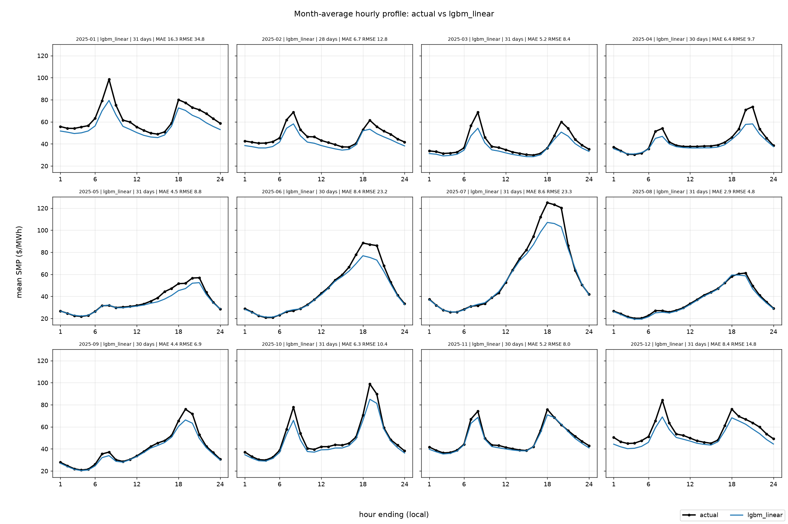
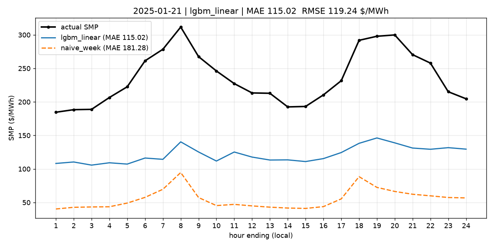

# PJM day-ahead SMP forecaster

Command-line tool that forecasts the **hourly PJM day-ahead (DA) system energy price (SMP, $/MWh)**
(`system_energy_price_da`; LMP = SMP + congestion + losses, only the SMP part is forecast).
The main model is LightGBM with piecewise-linear trees (`linear_tree=True`) predicting the SMP directly.

## Results at a glance (read this first)

All numbers are in $/MWh and come from the files in `outputs/` (regenerate with the commands in section 2). Walk-forward
means: for every forecast day the models are fitted on delivery days `2023-01-08 .. D-1` only, features are rebuilt for
each day with its own cut-off, and the models are refitted every 7 days (`backtest.retrain_every_days`, the spec's
default "for speed"; a daily-retrain run was **not** done). Hours are scored only where the actual and all five models
have a value. Skill = `1 - MAE / MAE(naive_week)`.

**2025 walk-forward (run `wf2025`, 8,757 hours)**

| Slice | lgbm_linear (main) | gbm_const | lear | naive_week | naive_day |
|---|---|---|---|---|---|
| Overall MAE / RMSE | **6.96 / 16.27** | 7.13 / 17.66 | 7.91 / 16.89 | 18.96 / 39.14 | 11.35 / 22.02 |
| Skill vs naive_week (MAE) | **0.633** | 0.624 | 0.583 | 0 | 0.401 |
| On-peak (HE8-23 Mon-Fri) | **9.31 / 21.28** | 9.57 / 23.27 | 10.80 / 21.85 | 25.90 / 50.89 | 14.26 / 27.27 |
| Off-peak | **4.92** / 10.05 | 4.99 / 10.56 | 5.39 / 10.87 | 12.91 / 24.68 | 8.82 / 16.10 |
| Top-5% price hours | 48.12 / 65.78 | 51.10 / 72.61 | **46.04 / 65.15** | 86.27 / 111.62 | 55.44 / 74.34 |
| Cold-snap days (top-5% `g_comp`) | 31.12 / 48.39 | 32.13 / 51.43 | **26.14 / 45.90** | 52.02 / 75.73 | 34.78 / 50.37 |

* The main model beats `naive_week` by 63% in MAE (and 58% in RMSE) and beats `gbm_const` on MAE and RMSE in every slice
  of the table (monthly MAE is mixed: `gbm_const` is slightly better in April, May and November). Linear leaves are
  worth about 0.16 $/MWh MAE and 1.4 $/MWh RMSE here: a real but modest gain.
* **Where it is weaker:** the LEAR benchmark is better in the most extreme conditions (top-5% hours, cold-snap days,
  January 2025: 13.9 vs 16.3 MAE). The main model under-predicts scarcity: see the plot of 2025-01-21 below, when gas peaked
  and the SMP was 185-310 $/MWh against a forecast of 105-145.
* Hardest hours are the morning ramp (HE7-8) and the evening peak (HE17-21); easiest months are August (MAE 2.9),
  May and September (4.4-4.5); hardest are January (16.3), July and June (8.4-8.6) and December (8.4).
  `outputs/backtest/wf2025/metrics.csv` has every breakdown (overall, on/off-peak, top-5%, cold-snap, each month, each hour).

**Extrapolation test (run `frozen2025`)**: models trained to 2024-12-31 and **never refitted** during 2025 (2025 prices
were about 50% above 2024). This isolates how well the linear leaves cope with a higher price level.

| Slice (MAE / RMSE) | lgbm_linear (main) | gbm_const | lear | naive_week | naive_day |
|---|---|---|---|---|---|
| Overall | **9.56 / 18.50** | 9.60 / 21.03 | 11.71 / 21.69 | 18.96 / 39.14 | 11.35 / 22.02 |
| Skill vs naive_week (MAE) | **0.496** | 0.494 | 0.382 | 0 | 0.401 |
| On-peak | **12.31 / 23.71** | 12.82 / 27.69 | 16.52 / 28.28 | 25.90 / 50.89 | 14.26 / 27.27 |
| Off-peak | 7.16 / 12.26 | **6.79** / 12.62 | 7.52 / 13.55 | 12.91 / 24.68 | 8.82 / 16.10 |
| Top-5% price hours | **56.12 / 71.37** | 64.27 / 85.05 | 63.33 / 80.38 | 86.27 / 111.62 | 55.44 / 74.34 |
| Cold-snap days | 33.16 / 49.50 | 35.96 / 55.83 | **31.44 / 48.37** | 52.02 / 75.73 | 34.78 / 50.37 |

* **Linear vs constant leaves.** With no refit, linear leaves are clearly better in the tail (RMSE 18.5 vs 21.0, top-5%
  hours 56 vs 64, on-peak MAE 12.3 vs 12.8) and tied on overall MAE (9.56 vs 9.60); constant leaves are slightly better
  off-peak (6.79 vs 7.16). That is the extrapolation benefit the spec asked about: real but moderate.
  The main model does beat both `gbm_const` and `naive_week` on this run (the spec asks for this to be checked and
  reported).
* **A frozen model ages.** Versus weekly retraining, freezing at 2024-12-31 costs 2.6 $/MWh MAE (9.56 vs 6.96). By October
  the frozen model is worse than `naive_day` (10.9 vs 8.6) and in March it is no better than `naive_week`. **The 2026
  submission uses a model frozen at 2025-12-31 for eight months, so expect accuracy nearer these frozen numbers than the
  weekly-retrained ones, and worse if the January 2026 gas regime is unlike anything in 2023-25.**

**Final validation, H2 2025 (run `wf2025h2`, 4,416 hours, weekly retrain)**: `lgbm_linear` MAE 5.81 / RMSE 11.99, `gbm_const`
6.01 / 13.26, `lear` 7.04 / 14.92, `naive_week` 17.33 / 36.00, `naive_day` 11.09 / 22.41.

**Group ablation on H2 2025** (`outputs/backtest/wf2025h2/ablation.csv`; main model refitted without each group, same
retrain schedule; positive = removing the group makes the error worse):

| Variant | Features left | MAE | RMSE | Change in MAE | Change in RMSE |
|---|---|---|---|---|---|
| Full model | 19 | 5.814 | 11.990 | - | - |
| without A (fuel: `g_comp`, `gas_basis_ew`) | 17 | 6.145 | 12.572 | +0.331 | +0.582 |
| without B (balance: `nl`, `tight`, `ren_share`, `ramp`, `nl_max`, `s_east`, `coal_share_7`) | 12 | 6.281 | 13.043 | +0.467 | +1.052 |
| without C (grid: `ci_lag1`, `spr_ew_lag1`, `mlf_ew_lag1`) | 16 | 5.773 | 11.838 | **-0.041** | **-0.153** |
| without D (price history: `smp_lag1`, `smp_lag7`, `dnl`) | 16 | 6.944 | 13.621 | +1.130 | +1.631 |
| without E (calendar) | 15 | 5.947 | 12.319 | +0.133 | +0.329 |
| without `coal_share_7` only | 18 | 5.746 | 11.909 | **-0.069** | **-0.081** |

Reading: price history (D) and the demand/supply balance (B) carry most of the information, followed by the fuel group
(A) and the calendar (E). **The grid-constraint group (C) and `coal_share_7` do not help in this period** (removing them
changes MAE by -0.04 and -0.07). They are reported as candidates for removal, as the spec asks, and were **not** removed.

**Explainability (H2 2025, `outputs/explain/`)**: __EXPLAIN__

**Plots to open** (all in `outputs/`):

* `plots/wf2025/months_overview.png` - the 2025 all-months overview (actual vs forecast, one panel per month):



* `plots/wf2025/day_2025-07-15.png`, `day_2025-01-21.png` (the worst case), `month_2025-07.png` (three models), one
  `month_YYYY-MM.png` per month. Month plots show the *average* hourly profile: `naive_week` looks close on the averaged
  profile of July but its hourly MAE is 25.3 against 8.6 for the main model. The MAE / RMSE in every title are computed
  on the hourly values, not on the averaged profile.
* `backtest/wf2025/timeseries_full.png`, `worst_weeks.png`, `error_by_hour.png`, `error_by_month.png` (same for `frozen2025`, `wf2025h2`).
* `explain/shap_importance.png`, `shap_beeswarm.png`, `shap_dependence_*.png`, `permutation_importance.png`, `ale.png`.



**Extrapolation probe (ad-hoc check, not part of the project).** The 2026 inputs contain a gas spike far outside the
training range (`g_comp` 94 $/MMBtu on 2026-01-28 against a training maximum of 23). Holding everything else at a cold
January 2025 weekday evening (HE19) and raising `g_comp` in the frozen model gives:

| `g_comp` ($/MMBtu) | 5 | 23 | 50 | 94 |
|---|---|---|---|---|
| Predicted SMP ($/MWh) | 79 | 119 | 139 | 172 |

Other tuned/untuned variants (15 leaves, lambda 0.1, 31 leaves) give 186-211 at 94. Nothing explodes, nothing is clipped,
but the slope beyond the training range is only about 0.7-1.2 $/MWh per $/MMBtu, far below the 7-10 a gas-fired
marginal unit would imply. **Expect the model to under-predict the late-January 2026 storm days**, and to recover once
`smp_lag1` reflects the high prices. Clipped hours are counted and logged by every run (none in any backtest).

**Not done / open items**

* The 2026 forecast CSV: the supplied files contain no 2026 DA prices (see section 2).
* A daily-retrain backtest (`--retrain-every 1`) was not run; weekly retraining was used throughout.
* The tuning grid was run on the 2025 walk-forward, which overlaps these backtests, so they are mildly optimistic.

## 1. Install

Python 3.11. From the project root:

```powershell
python -m venv .venv
.\.venv\Scripts\Activate.ps1
pip install -r requirements.txt
pip install -e . --no-deps        # makes `python -m pjmda` available (or: $env:PYTHONPATH="src")
```

Dependencies: pandas, numpy, pyarrow, lightgbm (>= 4.0), scikit-learn, shap, matplotlib, pyyaml.

Drop the raw CSVs into `data/raw/` (paths and globs are set in `config.yaml`). Every tunable value lives
in `config.yaml`: paths, hub codes, half-life, window lengths, floors, LightGBM parameters, cut-off time,
publication lags, clip bounds, `train.start`, `train.end`.

## 2. Commands

All commands are `python -m pjmda <cmd>` (add `--config path.yaml` before the command to use another config).

| Command | What it does |
|---|---|
| `clean [--raw-dir DIR]` | Parse and clean every file matching each dataset glob -> `data/clean/*.parquet`. Logs the effective training start. |
| `features [--start D --end D]` | Build the 19 model features + helper variables -> `data/features/features.parquet`, `helpers.parquet`. |
| `tune` | 12-combination grid on a 2025 walk-forward (training to 2024-12-31) -> `models/params.json`. |
| `backtest --start D --end D [--train-start D] [--retrain-every N] [--models a,b] [--ablation] [--run-name R]` | Walk-forward backtest -> `outputs/backtest/<R>/`. Refuses days after `train.end`. |
| `train --until D` | Fit and save `lgbm_linear`, `gbm_const`, `lear` (`--until` may not exceed `train.end`) -> `models/`. |
| `forecast (--date D \| --start D --end D) [--raw-dir DIR] [--model P] [--retrain] [--explain] [--plot] [--out F]` | Forecast; writes the 2-column CSV; prints a per-day summary. |
| `evaluate --start D --end D [--model P] [--forecast F] [--run-name R] [--plots]` | Score the frozen model (or a forecast CSV) against supplied actuals -> `outputs/test/<R>/`. |
| `plot (--pred P \| --run R [--source backtest\|test]) (--day D \| --month YYYY-MM \| --all-months) [--models a,b]` | Forecast-vs-actual plots from any predictions parquet. |
| `explain --start D --end D [--model P]` | SHAP, permutation importance, ALE, error breakdown -> `outputs/explain/`. |
| `run-all` | `clean` -> `features` -> `backtest` (2025, run `wf2025`) -> `train --until 2025-12-31`. Does not forecast 2026. |

Examples:

```powershell
python -m pjmda clean
python -m pjmda tune
python -m pjmda run-all
python -m pjmda backtest --start 2025-07-01 --end 2025-12-31 --run-name wf2025h2 --ablation
python -m pjmda backtest --start 2025-01-01 --end 2025-12-31 --run-name frozen2025 --retrain-every 400
python -m pjmda train --until 2025-12-31
python -m pjmda forecast --date 2026-02-10 --explain --plot
python -m pjmda evaluate --start 2026-01-01 --end 2026-08-31 --plots
python -m pjmda plot --run wf2025 --day 2025-07-15
python -m pjmda plot --run wf2025 --month 2025-07 --models lgbm_linear,naive_week
python -m pjmda plot --run test2026 --source test --all-months
python -m pjmda explain --start 2025-07-01 --end 2025-12-31
```

### Interview workflow (after the 2026 files are received)

1. Copy the 2026 files into `data/raw/` (e.g. `da_prices_2026.csv` next to `da_prices_2023_2026.csv`; any file
   matching a dataset glob is picked up, rows are concatenated and de-duplicated, the most recently modified
   file wins on conflicts and a warning is logged).
2. `python -m pjmda clean`
3. `python -m pjmda forecast --start 2026-01-01 --end 2026-08-31 --out outputs/forecast_2026-01-01_2026-08-31.csv`
   (the submission CSV: exactly the columns `datetime_beginning_ept`, `da_price_forecast`, 5,831 rows because
   2026-03-08 has 23 hours).
4. `python -m pjmda evaluate --start 2026-01-01 --end 2026-08-31 --plots` (if the 2026 actuals are included).
   Add `--forecast outputs/forecast_2026-01-01_2026-08-31.csv` to score the submitted file instead of re-predicting.

Live forecast on the spot: `python -m pjmda forecast --date YYYY-MM-DD --explain --plot` (about 8 s from raw
files; `forecast` only re-cleans raw files whose modification time or size changed).
If a DA price input (D-1 or D-7 results) is missing, `forecast` and `evaluate` stop with an error that names
the missing dates and the file they were expected in. There is no fallback model.

I rehearsed this whole workflow in a scratch folder with a synthetic 2026 DA file (2025 prices shifted by one year):
two DA files merged by `clean`, a 5,831-row submission CSV in under a second, `evaluate` on the model and on the CSV
(identical scores), and the `plot` commands. The accuracy of that rehearsal is meaningless (fake actuals); it only
proves the mechanics. **No 2026 forecast has been produced yet**: the supplied files contain no 2026 DA prices,
and the spec says the submission is produced only after they arrive.

## 3. Information cut-off and vintages (the most important rule)

The forecast for delivery day D may only use data available **before 10:30 EPT on D-1**
(`cutoff(D)`, configurable). Every clean table carries `available_at` (tz-aware EPT) and every feature is built
with the single function `vintage.asof_select(df, keys, cutoff)`: rows with `available_at < cutoff`, latest
`available_at` per key.

| Dataset | `available_at` | Notes |
|---|---|---|
| DA prices | `(opr_date - 1 day) 13:30` | Results of D-1 are posted on D-2, so usable; D itself is not. |
| Gas | `(report_date + 1 day) 00:00` | Usable for D only if `report_date <= D-2`; late revisions are excluded. |
| Outages | `posting_timestamp` | Posted at 00:00 on D-1. |
| Load, wind, solar forecasts | `forecast_timestamp` | One vintage per target date in the files, issued about 10:17 on D-1. |
| Generation by fuel (actuals) | `ts_begin + 1 h + 24 h` | No publication time in the file: conservative lag (`gen_by_fuel.publish_lag_hours`). |

How the selection was verified: for several days (including DST days) I compared the features with the raw files.
The load used equals the raw vintage issued before the cut-off; `smp_lag1/7` equal the raw prices of D-1/D-7; gas uses
the flow date D-1 with `report_date <= D-2` (the index for flow date D is excluded); and `coal_share_7` recomputed
from the 168 generation hours available before the cut-off matches the feature to the last digit.

## 4. Missing data and data inconsistencies: what was found, what was done

Everything below is logged by `clean` / `features`, and every fallback sets a flag in `data/features/helpers.parquet`
(`stale_*`, `filled_*`, `gas_filled`, `cref_warmup`). Flags are helper variables: they are never model inputs.
Counts are for delivery days 2023-01-08..2025-12-31 (training / backtest) and 2026-01-01..2026-08-31 (test inputs).

### 4.1 Missing data

| What is missing | Where / when | Handling | Flag |
|---|---|---|---|
| History before 2023-01-01 | All files start 2023-01-01 (`train.start` is 2022-01-01) | No history is fabricated. **Effective training start = 2023-01-08** (latest file start + 7 warm-up days for `smp_lag7`). Logged by `clean`. | - |
| **2026 DA prices** | The DA file ends 2025-12-31; all other inputs run to 2026-08-31 | Nothing is invented. `forecast` / `evaluate` stop with an error naming the missing D-1 / D-7 dates and the file expected. No fallback model, no substituted forecasts. | error |
| RTO load forecast for a whole date | 2025-01-13, 2025-03-27, 2026-08-19 | Same hour of D-7 (then D-14) taken through its own cut-off. | `stale_load` |
| `MID ATLANTIC REGION` load for a date | 18 dates: 2023-05-31, 2023-07-04, 2023-08-31, 2023-10-14, 2023-12-22, 2024-04-15, 2024-07-18, 2025-01-09, 2025-01-13, 2025-03-27, 2025-11-08, 2025-12-30, 2026-01-09, 2026-03-27, 2026-04-11, 2026-05-23, 2026-08-08, 2026-08-19 | Copied from D-7 per region (the other regions keep their D-1 vintage). Affects `s_east` and the `g_comp` weights only. | `stale_load` |
| `SOUTHERN REGION` / `WESTERN REGION` load for a date | South: 2025-01-13, 2025-03-27, 2026-08-19. West: 2025-03-27 | Same D-7 copy. | `stale_load` |
| Load vintage older than 12 h at the cut-off | 2023-12-17, 2025-11-24 | Used (latest available) but flagged. | `stale_load` |
| Load label 2 on the fall-back day | 2023-11-05 (1 hour) | Linear interpolation inside that day's forecast (gaps of up to 2 h). | `filled_load` |
| Solar forecast for a whole date | 2023-10-10 (and the 2023-10-09 vintage is older than 12 h) | D-7 copy / flag. | `stale_solar` |
| Solar hour 24 (and spring-forward hour) | 83 days in Jan-Mar 2023 (labels run 0-23, see 4.2) plus the spring-forward days | Trailing night hour filled from the previous hour (solar is 0 at night) | `filled_solar` |
| Wind forecast | Complete (2023-10-29 has one vintage older than 12 h and 3 interpolated hours) | Flagged / interpolated. | `stale_wind`, `filled_wind` |
| Outages (PJM RTO) for a date | 2023-09-17, 2024-03-17, 2024-09-18, 2024-09-19 | Latest earlier posting reused (at most 7 days back). | `stale_outages` |
| Gas hub price for the flow date D-1 | 15 delivery days: 2023-04-09/10, 2023-11-25/26/27, 2023-12-31, 2024-01-01/02/03, 2024-02-08..11, 2024-09-01, 2024-12-01 | Last known price per hub, forward-filled for at most 4 days; none of the 2026 days needs a fill. | `gas_filled` |
| Null gas prices `(null)` | 82 rows over the six hubs (17 for Transco Z5 with suffix `21`) | Treated as missing, then forward-filled as above. | `gas_filled` |
| DA hour in the 23-label spring-forward day | 2023-03-12, 2024-03-10, 2025-03-09 (2026-03-08 in the test period) | The hour does not exist. The next day's hour-3 lag and the D+7 hour-3 lag are NaN (3 hours per feature in training). LightGBM handles NaN natively; they are never encoded as 0. | NaN |
| Generation-by-fuel hours | 6 gaps of 2-4 hours (2023-02-22, 2023-04-12, 2025-07-01, 2025-11-02, 2026-02-18, 2026-06-25) | Nothing filled: `C_ref` is a maximum and `coal_share_7` a ratio of sums, so gaps are simply skipped; `coal_share_7` needs at least 24 hours in its window. | - |
| `g_comp` when every regional gas price or load weight is missing | Never happens in the data | Weights are renormalised over the regions present; if none is present `forecast` / `evaluate` stop with an error. | error |

How many hours are flagged: training period `stale_load` 336 h (14 days), `stale_wind` 21 h, `stale_solar` 48 h,
`stale_outages` 96 h, `filled_load` 1 h, `filled_wind` 3 h, `filled_solar` 84 h, `gas_filled` 360 h (15 days).
2026: `stale_load` 144 h (6 days: 2026-01-09, 03-27, 04-11, 05-23, 08-08, 08-19), `filled_solar` 1 h, nothing else.

### 4.2 Inconsistencies in the data

| Inconsistency | Evidence | Handling |
|---|---|---|
| **DST encoding.** Files use wall-clock hour-ending labels 1-24. Spring-forward days have 23 labels; fall-back days have only **24** labels, so the repeated hour has no DA price. Generation by fuel is UTC based (25 exact hours). | e.g. DA 2023-11-05: labels 1-24, one row each | `ts_begin` is built from the wall clock (unique timestamps); the repeated hour resolves to its first occurrence. Forecast files have 23 rows on spring-forward days (5,831 rows for 2026-01-01..08-31) and 24 on fall-back days. |
| **Solar hour labels.** The column is called `hour_ending` but the first 88 forecast days (2023-01-01..2023-03-29) are labelled 0-23; all later days 1-24. | Alignment against actual solar generation: label k matches the hour ending at k in both groups | Convention stays `hour_ending` (`solar.hour_convention`, a config value). Label 0 falls outside the day and is dropped; the missing trailing night hour is filled. Only night-time values of early 2023 are affected. |
| **Gas file is not CSV.** The `description` has unquoted commas, so rows have 5-8 fields, some with trailing empty fields; prices can be `(null)`. | 250,214 rows, 0 unparseable after the fix | Each line is split from both ends (`fields[0]` flow_date, `[1]` code, `[-1]` report_date, `[-2]` price, the middle is the description). |
| **Two parallel gas series** per hub (codes ending `21` and `04`) with very different values on some days (Algonquin 2023-01-02: 2.965 vs 23.693). | Different products | Only `gas.suffix` (default `21`) is used, never mixed in one feature. **Assumption to confirm with the organisers.** |
| **Late gas revisions / packages.** Rows for flow date 2024-01-01/02 carry `report_date` 2024-12-31 (a year late, probably a typo); weekend packages put several flow dates under one report date. | 12 rows (suffix `21`), 18 in total | `available_at = (report_date + 1 day) 00:00`: a late row only becomes usable in 2025, so the 2024-01-0x delivery days are forward-filled (flagged). Weekend packages follow the same rule: usable for D only if `report_date <= D-2`. |
| **Duplicated generation-by-fuel rows** (30 exact duplicates, e.g. 2023-12-31 05:00 UTC). `Other` fuel appears in only 1,140 hours. Storage can be negative. | | Duplicates dropped; `Other` is summed when present; storage is not clipped. |
| **Several clean files for one dataset** (the interview drops a 2026 file next to the old one). | | Rows de-duplicated across files; on a conflict the most recently modified file wins and a warning is logged. |
| **SMP identical at every node?** | Checked: the spread across nodes is zero in every hour | One value per hour taken from the hourly median of all nodes; merchant-line nodes (NEPTUNE, LINDENVFT, HUDSONTP) are excluded from every feature. |
| **Price spikes** | DA prices up to 537 $/MWh in the lags | Kept: they are real. The Huber objective limits their leverage on the fit. |
| **`C_ref` warm-up.** The capacity proxy needs 365 days of generation history. | 358 days (8,591 hours) of 2023 are flagged | Expanding maximum during the first year (flag `cref_warmup`), so `tight` is less comparable in 2023. Option `capacity.exclude_warmup_from_training: true` drops those rows. |
| **Gas far outside the training range in 2026.** | `g_comp` reaches 94 $/MMBtu on 2026-01-28 (training max 23.0 on 2025-01-21); Transco Z6/Z5 near 135 | Nothing is clipped or removed. This is where the linear leaves have to extrapolate (see Limitations). |

## 5. Features (19, one model, all always used)

HELPER variables are intermediate quantities and are never passed to the model; they are stored in
`data/features/helpers.parquet`. Only the 19 columns below reach LightGBM.

| # | Feature | Plain-English formula | Mechanism | Source |
|---|---|---|---|---|
| 1 | `g_comp` | Load-weighted regional gas price: `w_midatl*g_midatl + w_south*g_south + w_west*g_west` ($/MMBtu); weights renormalised over regions present | Gas units are usually marginal, so fuel cost sets the price level; weighting by regional load reflects where marginal units run; linear leaves let price follow gas outside the training range | [S1][S3] |
| 2 | `gas_basis_ew` | `g_midatl - g_west` | When pipelines into the East are constrained (cold snaps) eastern gas decouples from Appalachian supply and the stack steepens (Winter Storm Elliott) | [S1] |
| 3 | `nl` | `L_rto - W - S` (MW) | Wind and solar have near-zero marginal cost, so dispatchable plants only serve net load | [S2] |
| 4 | `tight` | `nl / (C_ref - out_total)` | Position on the supply curve: flat at low utilisation, convex near capacity; outages enter by reducing available capacity | [S2][S1] |
| 5 | `ren_share` | `(W + S) / L_rto` | High renewable share at equal net load means more inflexible thermal cycling and oversupply (low/negative overnight and midday prices) | [S1][S2] |
| 6 | `ramp` | `nl(h) - nl(h-1)`; HE1 uses HE24 of D-1 from the latest vintage before `cutoff(D)` | Steep ramps (post-solar evening, HE17-HE19) need fast-start, more expensive units | [S1] |
| 7 | `nl_max` | Daily maximum of `nl` | The DA market commits units for the whole day: the day's peak decides what is committed and lifts shoulder hours | [S6] |
| 8 | `s_east` | `(L_midatl + L_south) / L_rto` | East and south load must partly be served over constrained interfaces by western generation, bringing expensive local units on the margin (East Coast and Dominion data-centre load) | [S1] |
| 9 | `coal_share_7` | `sum(coal) / sum(coal + gas)` over the last 168 hours of generation actuals available before the cut-off | A larger coal share means coal units set the price more often (changes how strongly price follows gas); tracks coal retirements the gas price cannot see | [S1][S5] |
| 10 | `hour` (cat.) | Hour ending 1-24 | Daily demand cycle and solar shape | [S1] |
| 11 | `dow` (cat.) | Day of week 0-6 | Commercial/industrial load and weekend unit commitment; Monday differs from mid-week | [S6] |
| 12 | `is_holiday` (cat.) | NERC holiday (New Year, Memorial, Independence, Labor, Thanksgiving, Christmas; Sunday -> Monday) | Holiday load looks like weekend load | [S6] |
| 13 | `month` (cat.) | Month 1-12 of D | Seasonal structure not in load and gas (maintenance seasons, summer vs winter fleets); December and January are separate categories so no sin/cos is needed | [S1] |
| 14 | `ci_lag1` | Mean over the `*_RESID_AGG` zones of `abs(C_z)` of D-1, same hour, divided by `smp1_abs` | Binding constraints force out-of-merit dispatch; system-wide congestion intensity measures how much the grid distorted dispatch yesterday and such patterns persist | [S3][S1] |
| 15 | `spr_ew_lag1` | `(C_EASTERN_HUB - C_WESTERN_HUB)` of D-1 / `smp1_abs` | The classic west-to-east transfer constraint: when it binds, eastern load is served by more expensive local generation | [S1] |
| 16 | `mlf_ew_lag1` | `(M_EASTERN_HUB - M_WESTERN_HUB)` of D-1 / `smp1_abs` | Marginal losses grow with the flow (losses ~ current squared, standard physics), so the loss spread measures transfer volume even when no constraint binds (when `spr_ew` is 0): information beyond feature 15 | [S3] |
| 17 | `smp_lag1` | SMP of D-1, same hour | Prices are persistent; yesterday's price carries scarcity and bidding conditions the fundamentals do not show | [S4] |
| 18 | `smp_lag7` | SMP of D-7, same hour | Same weekday last week (the client's naive benchmark) captures the weekly pattern | [S4] |
| 19 | `dnl` | `nl(D,h) - nl_fcst(D-1,h)`, the latter built from the vintages selected at `cutoff(D-1)` | How much tomorrow's fundamentals differ from the day behind `smp_lag1`; only meaningful together with `smp_lag1` | design |

Sources: [S1] ElectronX, "PJM: Beyond Western Hub" (Apr 2026), https://docs.electronx.com/pjm-beyond-western-hub ·
[S2] Montel, "Price Fluctuation Causes in the Power Market",
https://montel.energy/resources/blog/factors-influencing-price-fluctuation-causes-in-the-power-market ·
[S3] Monitoring Analytics, 2017 State of the Market Report for PJM, Sec. 11,
https://www.monitoringanalytics.com/reports/PJM_State_of_the_Market/2017/2017-som-pjm-sec11.pdf ·
[S4] Lago, Marcjasz, De Schutter, Weron (2021), Applied Energy 293, 116983, https://arxiv.org/abs/2008.08004 ·
[S5] Monitoring Analytics, 2025 State of the Market Report for PJM (press release and Sec. 7),
https://www.monitoringanalytics.com/reports/Market_Messages/Messages/2025-som-pjm-press-release.pdf ·
[S6] general power-market practice (DA unit commitment over the whole day, weekday/holiday load patterns), standard
domain knowledge, not a citation ·
[S7] LightGBM documentation, Parameters (`linear_tree`), https://lightgbm.readthedocs.io/en/latest/Parameters.html.

Monotone constraints (split level only): +1 on `tight`, `nl`, `nl_max`, `g_comp`; -1 on `ren_share`.
`hour`, `dow`, `is_holiday`, `month` are declared categorical: with `linear_tree=True` every numerical feature in a
leaf's branch enters that leaf's regression, and a linear term in an hour or weekday index is meaningless.

### Helper variables (never model inputs)

* From load/wind/solar forecasts (hourly, day D): `L_rto, L_midatl, L_south, L_west`, `W`, `S`.
* Gas (daily): the six hub prices (`gas_<HUB>`), `g_midatl`, `g_south`, `g_west`, `gas_filled`, load shares
  `w_midatl, w_south, w_west` (daily mean regional load / daily mean RTO load).
* Outages: `out_total` (PJM RTO total outages for day D, MW).
* Generation actuals, lagged: `C_ref` = trailing 365-day maximum of `gen_total + out_total` of that hour's operating
  day (a lower bound of installed capacity, expanding maximum before 365 days exist with `cref_warmup=1`; it ignores
  net imports and only falls when the peak leaves the window).
* DA prices of D-1 (same hour): `C_x`, `M_x` (congestion and marginal-loss components), `smp1_abs = max(|SMP(D-1,h)|, 1)`.
* Metrics only: `on_peak` (HE8-HE23, Mon-Fri, not a NERC holiday), used to break down errors, not a feature.
* Flags: `stale_load/wind/solar/outages`, `filled_load/wind/solar`, `gas_filled`, `cref_warmup`.

### Dropped features (and why)

Redundant (no information beyond the kept set):

* Raw `W`, `S`, `L_rto`: fully captured by `nl`, `ren_share` and `hour`.
* `tight_plus` (squared excess tightness): a transform of `tight`; tree splits plus leaf slopes already model the convex region.
* `nl_min`, `nl_rel` (= `nl / nl_max`): `nl_rel` is a deterministic combination of two kept features; overnight oversupply is covered by `nl` and `ren_share`.
* `ramp_eve` (daily maximum evening ramp): covered by the hourly `ramp`.
* `s_dom`, `s_midatl` separately: with the western share they sum to 1; `s_east` carries the east-vs-west information.
* `f_forced`, `f_west`, `out_forced`, `out_total` as separate features: outages enter through `tight`. The forced/planned split matters for real-time surprises, not for the DA energy price once outages are posted.
* `dg1` (day-on-day gas change): `g_comp` gives the level; together with `smp_lag1` the change adds little.
* `smp_d1_mean`, `smp_d1_max`, `smp_h_7`: highly correlated with the kept lags.
* `spr_dom`, `spr_ni`, interface spreads (MISO, SOUTH, NYIS, IMO), `mlf_wh`, `mlf_eh`, `mlf_dom`, 7-day congestion means: mostly local basis (affect LMP, not SMP) or collinear with `ci_lag1` / `spr_ew_lag1` / `mlf_ew_lag1`.
* `on_peak`, `is_dst_day`: deterministic from hour, dow and holiday; kept as helper/metric flags only.

Not allowed or not available:

* Actual load, wind or solar for day D (look-ahead).
* Generation-by-fuel actuals after the cut-off minus the publication lag.
* Gas index for flow day D (published after the cut-off); late-revised gas rows.
* Real-time prices, DA-RT spreads, installed capacity, binding-constraint data: not in the provided datasets, and no other data was pulled.
* All other gas hubs, individual load zones, merchant-line nodes (NEPTUNE, LINDENVFT, HUDSONTP), mixing the `04` and `21` gas series.

## 6. Model

* **Target.** `y = SMP(D,h)` in $/MWh, predicted directly (identity target in `model.target_fn`, the only place to
  change it). Predictions are clipped to [-50, 1000] and the number of clipped hours is logged.
* **Main model `lgbm_linear`.** LightGBM with `linear_tree=True` [S7]: splits are chosen as usual, but each leaf holds
  a ridge regression (`linear_lambda`) on the numerical features of its branch instead of a constant. The forecast can
  therefore keep rising with gas and tightness beyond the training range instead of flattening at the largest training
  value. Objective `huber` (alpha 10 $/MWh): spikes are heavy-tailed and the scoring is MAE/RMSE; `l1` is not supported
  with linear trees [S7].
* **Caveats.** (i) Numerical features are standardised with mean/std fitted on the training window only, re-fitted at
  every retrain, saved with the model and applied unchanged at prediction time. (ii) NaNs stay NaN (a leaf falls back
  to its constant). (iii) Monotone constraints are enforced when choosing splits but **not** inside the leaf
  regressions, so the final response can still violate them. (iv) The first tree has constant leaves. (v) Leaf models can
  extrapolate wildly far outside the training range; clipping bounds the damage.
* **Training window.** Every fit uses only delivery days `effective start .. min(D-1, train.end)`; nothing from 2026
  is ever used to fit or tune. Sample weights `0.5 ** (age_days / 180)`. Early stopping (100 rounds) on the **last 60 days**
  of the window (time ordered, never random); then the model is refitted on the full window with the best iteration.
* **Baselines.** `naive_week` (SMP of D-7, the client's benchmark), `naive_day` (SMP of D-1), `lear` (24 per-hour
  LassoCV models with `TimeSeriesSplit` on asinh-transformed, standardised prices; inputs: same-hour prices of D-1, D-2,
  D-3, D-7, all 24 hours of D-1, `g_comp`, the group-B features and calendar dummies [S4]), `gbm_const` (the same
  LightGBM with `linear_tree=False`, isolating the effect of the linear leaves).
* **Tuning.** Only inside the training data: 2025 walk-forward with training to 2024-12-31, 12 of the 18 combinations of
  `num_leaves {7,15,31}`, `min_data_in_leaf {100,300}`, `linear_lambda {0.1,1,10}`; learning rate and half-life fixed.
  Chosen: `num_leaves=7, min_data_in_leaf=100, linear_lambda=1.0` (saved in `models/params.json`, used by every later
  fit). The differences between combinations are small (MAE 7.5-8.0). The grid was run twice during development
  (before and after an experiment on the load features that I reverted) and picked the same winner both times.
  Note: the 2025 backtests below overlap the tuning period, so they are slightly optimistic for the tuned parameters.
* **Persistence.** `models/<name>_<until>.txt` (LightGBM native, includes the leaf regressions) plus a JSON with the
  feature list, categorical features, scaler mean/std per feature, training window, config hash and git commit.

## 7. Layout

```
config.yaml              all tunable values
src/pjmda/
  cli.py                 argparse entry point (python -m pjmda <cmd>)
  config.py              load config.yaml
  clean.py               one loader/cleaner per raw dataset
  vintage.py             cut-off logic, generic as-of selection, DST-safe time helpers
  features.py            helper variables + the 19 model features (pure functions)
  model.py               scaling, LightGBM fit/predict, LEAR, naive baselines, train/forecast
  backtest.py            walk-forward loop, metrics, ablation, tuning, test evaluation
  explain.py             SHAP, permutation importance, ALE, error breakdown
  plots.py               day / month / overview plots and summary plots
data/raw  data/clean  data/features  models  outputs
```

Every stage writes parquet so stages can be re-run independently (`features` always rebuilds from the clean tables;
it takes about a second for the whole training period).

## 8. Known limitations

* **Spikes.** The Huber objective and MAE/RMSE scoring favour typical hours; scarcity spikes are systematically
  under-predicted (see the top-5% hours and cold-snap rows above and the peak hours in the month plots).
  RMSE is dominated by a handful of days (January and late June / July 2025).
* **Leaf models can extrapolate wildly.** Linear leaves have no built-in bound; monotone constraints are only
  enforced at splits, and ridge shrinkage (`linear_lambda`) plus clipping to [-50, 1000] are the only guards.
  In the tuned model the response is gentle rather than wild (see "Extrapolation probe" above), but it has never been
  validated beyond `g_comp` = 23, and the 2026 file contains 94. The number of clipped hours is logged by every
  backtest, `forecast` and `evaluate`; more than a handful would mean the leaves extrapolate badly and must be reported.
* **`C_ref` is a proxy.** `max(generation + outages)` ignores net imports and only falls when the peak hour leaves the
  365-day window. For the first year it is an expanding maximum, which makes `tight` less comparable with later years.
* **2026 forecasts depend on the 2026 DA file being complete.** `smp_lag1` and `smp_lag7` (and the congestion/loss
  features of D-1) come from the supplied DA results; a missing day stops `forecast`/`evaluate`. After the first
  forecast days the lags are actuals, not forecasts: errors do not compound, but nothing is available beyond the file.
* **Assumptions to confirm with the organisers:** gas suffix `21` (not `04`), a 24-hour publication lag for
  generation by fuel actuals, solar `hour_ending`, and that the wall-clock label mapping used for DST days matches
  the data source (fall-back days have 24 labels in the files, so the repeated hour has no DA price).
* **Vintage coverage.** The files hold one forecast vintage per region and target date, so the "older vintage"
  fallback is only exercised by missing dates, where the D-7 copy is used (section 4). With several vintages per
  date (live use) the rule picks the latest one issued before the cut-off.
* **Tuning overlap.** Hyperparameters were chosen on the 2025 walk-forward, so the 2025 numbers are mildly optimistic
  for the tuned parameters. The 2026 test period was never used for fitting, tuning or feature selection.
* **No uncertainty bands, point forecasts only; only the SMP, not LMP.**
